# Gestão de resíduos sólidos
Projeto realizado para a matéria Programação Back-End 1 do curso de Desenvolvimento de Sistemas do SENAI

## Diagrama de classes
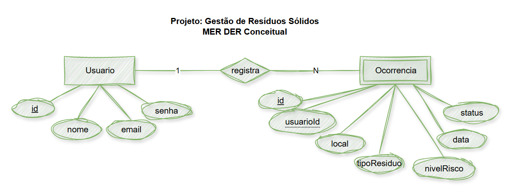
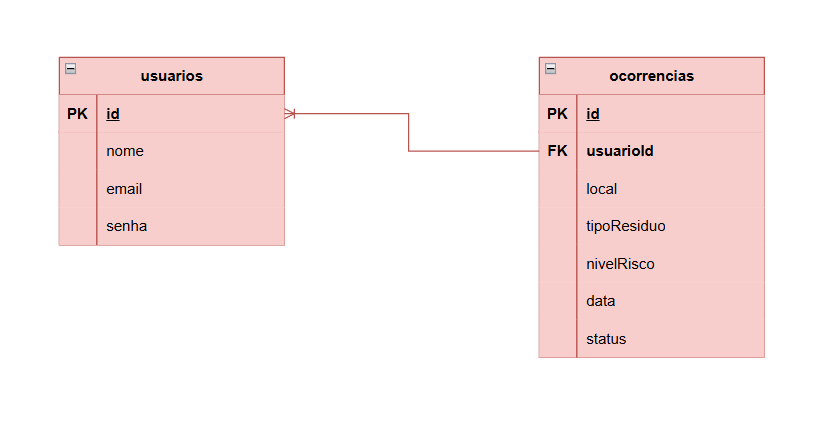

 

|Tecnologias utilizadas|Para que foi utilizada|
|-|-|
|VS code|Programação dos códigos|
|Draw.io|Desenho do MER DER|
|Node.js|Rodar o javascript|
|GitHub|Armazenar o projeto|
|Insomnia|Teste do CRUD|
|XAMPP|Utilizar o banco de dados MySQL|

 

## Passo a passo para testar
- Clone este repositório em seu pc
- Abra a pasta com um compilador (geralmente VS code)
- Rode o servidor no cmd utilizando o comando <kbd>npm run dev</kbd>
- Abra o Insomnia e teste as HTTP requests seguindo o CRUD (Create, Read, Update, Delete), adicionando também o resumo, login e o patch (substitui o PUT no ocorrências)

 

## Prints dos testes no Insomnia
- Usuários
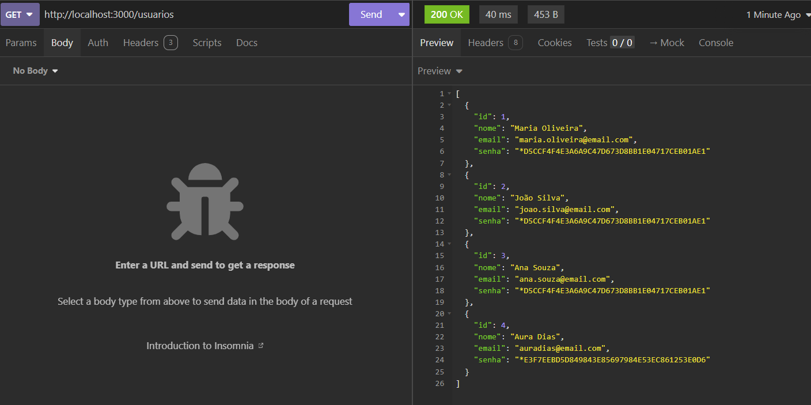
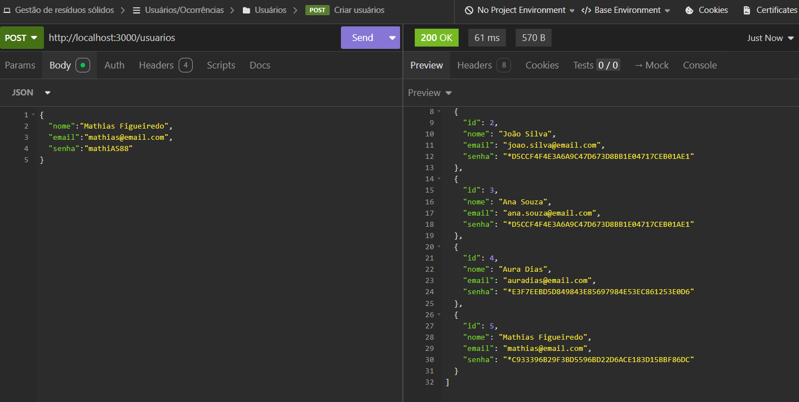
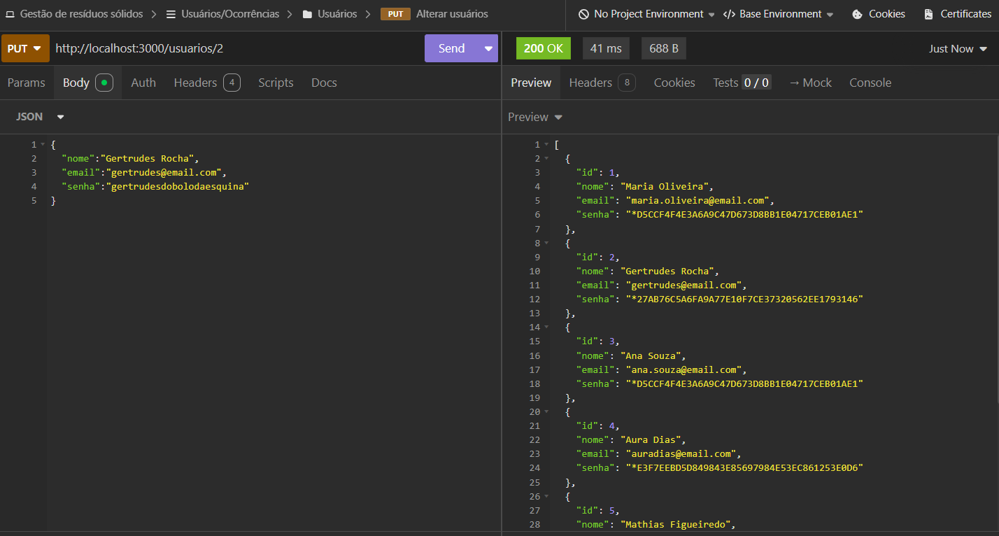
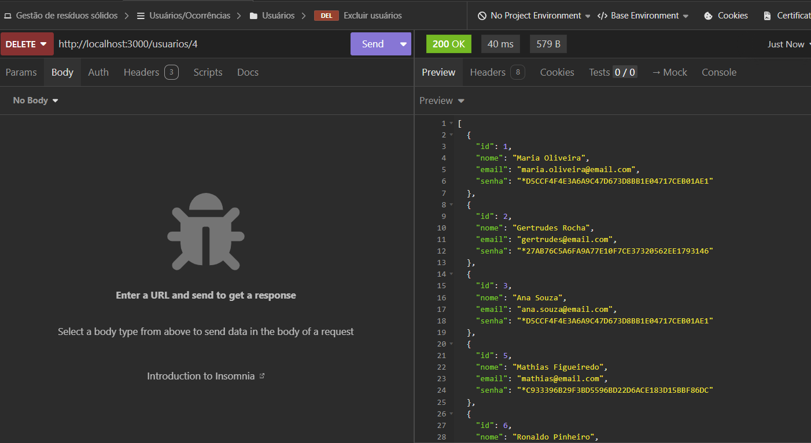
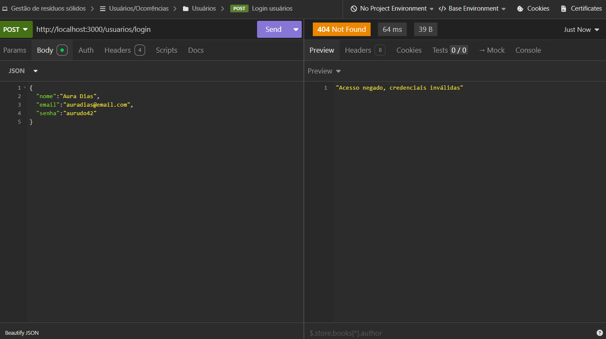
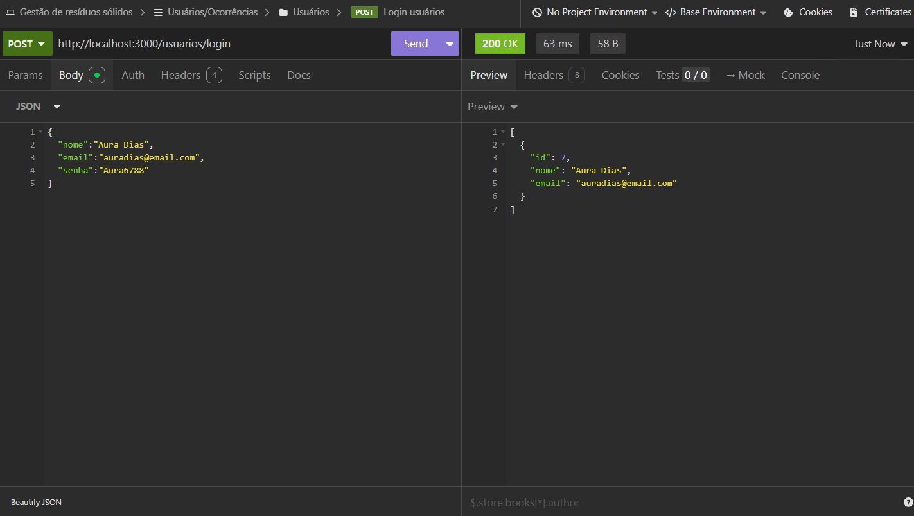
- Ocorrências
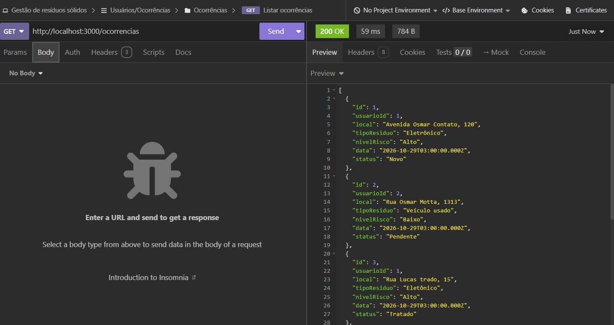
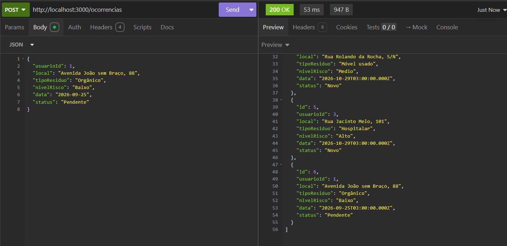
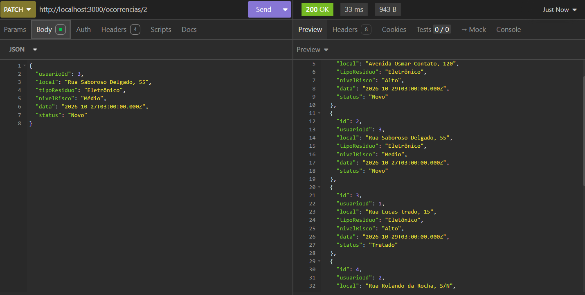
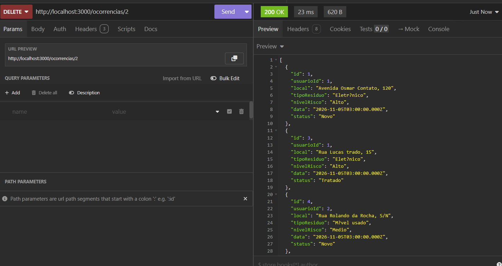
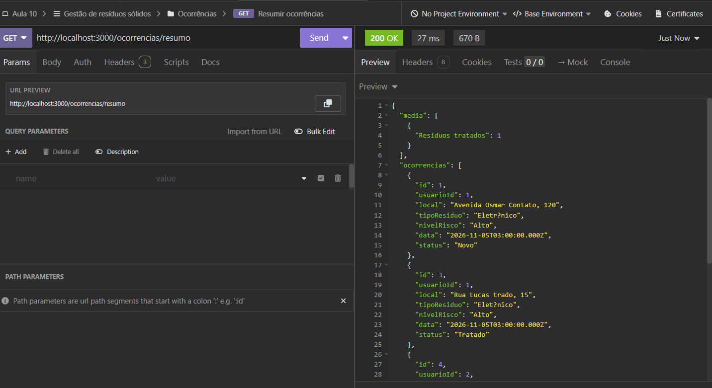